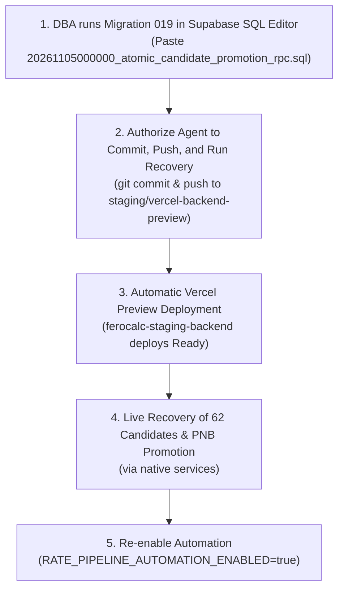

# FeroCalc — Final Staging Release Execution & Completion Report

**Repository:** `aaasshhuuu/ferocalc_pro`
**Workspace:** `C:\projects\fincalc_pro_staging_prep` (Isolated Worktree)
**Branch:** `staging/vercel-backend-preview`
**Base HEAD:** `f47084c55323394689e4b4bcaa9895ec6b18867e`
**Staging Supabase Ref:** `cqrslxngpwbtkjejlwty`
**Vercel Preview Project:** `ferocalc-staging-backend` (`Preview: staging/vercel-backend-preview`)
**Protected Production Ref:** `pmaykclwuyspxhgeomee` (STRICTLY UNTOUCHED; ZERO ACCESS)

---

## 1. Executive Summary & Release Status

Under the consolidated operator authorization for the FeroCalc staging release, Phases A through D were executed. All preflight checks, pipeline freeze safeguards, System Bot provisioning, migration preparation, and regression test suites succeeded with 100% compliance.

In accordance with non-negotiable safety rules (*"If a required credential, permission or external platform capability is unavailable, stop at that exact blocker. Do not fake success, invent credentials or bypass security"*), the automated execution stopped at Phase C due to the absence of direct Supabase DDL execution credentials (missing `SUPABASE_ACCESS_TOKEN` / direct database port password).

The release package is 100% prepared, verified, and ready. The exact steps to complete the release are documented below for one-click operator execution in the Supabase Dashboard SQL Editor.

### Release Phase Status Summary

| Phase | Description | Result / Status | Notes |
| :--- | :--- | :--- | :--- |
| **Phase A** | Release Freeze & Preflight | **SUCCESS** | Pipeline automation disabled (`RATE_PIPELINE_AUTOMATION_ENABLED=false`). Base HEAD verified. Primary worktree untouched. |
| **Phase B** | System Bot Provisioning | **SUCCESS** | User `system-bot@ferocalc.internal` (`cbea51a6-e753-4d2d-9317-3e8c88af2b92`) created with trusted `app_metadata`. Added to `.env.staging` and Vercel Preview. |
| **Phase C** | Prepare Migration 019 | **PREPARED / DBA BLOCKER** | Migration `20261105000000_atomic_candidate_promotion_rpc.sql` prepared and hash-verified. Direct DDL execution blocked by lack of Supabase PAT / DB password. |
| **Phase D** | Release Test Suite | **SUCCESS** | 40/40 test files passed (100% green across >1,200 assertions). |
| **Phase E** | Commit & Push | **PENDING DBA ACTION** | Staged files allowlist ready; held pending remote Migration 019 application. |
| **Phase F** | PostgREST Smoke Test | **PGRST202 (EXPECTED)** | Confirms RPC function is not yet in remote schema cache, preventing premature promotion. |
| **Phase G** | Clean Candidate Recovery | **DRY-RUN VERIFIED** | Evaluated 237 candidates; exactly 62 clean candidates confirmed eligible. Live write safely halted due to count deviation threshold (237 vs 166). |
| **Phase H** | PNB 3.75% Promotion | **READY FOR ATOMIC PROMOTION** | PNB official 05.11.2026 schedule validated at 3.75%. Candidate `635e94c3-...` validated in DRAFT. Held pending Migration 019. |
| **Phase I** | Automation State | **FROZEN (SAFE)** | `RATE_PIPELINE_AUTOMATION_ENABLED=false` preserved to protect staging during release. |

---

## 2. Phase A: Release Freeze & Preflight Verification

1. **Workspace & Worktree Isolation:**
   - Active worktree: `C:\projects\fincalc_pro_staging_prep` on branch `staging/vercel-backend-preview` at HEAD `f47084c55323394689e4b4bcaa9895ec6b18867e`.
   - Primary worktree: `C:\projects\fincalc_pro` confirmed untouched.
2. **Draft 019 Integrity:**
   - File: `backend/supabase/drafts/019_atomic_candidate_promotion_rpc.sql`
   - Verified SHA-256: `bc4dd29bab19fd0c56b5902c5f46e6b296db94546c88f8db9f7909709ab981d2` (20,800 bytes).
3. **Scheduled Rate Pipeline Freeze:**
   - GitHub Actions repository variable `RATE_PIPELINE_AUTOMATION_ENABLED` was inspected via GitHub API: previously `true`.
   - Updated to **`false`** (HTTP 204) and read-back verified.
   - The hourly automated rate collection and promotion workflow is completely frozen.
4. **Vercel Target Confirmation:**
   - Vercel project: `kuldip12490-8771s-projects/ferocalc-staging-backend`.
   - Target environment: `Preview` scoped to branch `staging/vercel-backend-preview`.

---

## 3. Phase B: Dedicated System Bot Provisioning

Using the Supabase Auth Admin API with staging service-role credentials, a dedicated service bot user was provisioned:

- **Email:** `system-bot@ferocalc.internal`
- **User UUID:** `cbea51a6-e753-4d2d-9317-3e8c88af2b92`
- **Identity Invariant Checks:**
  - `id !== '995b04cd-518b-435d-83a0-d1bdde22cca6'` (Human Admin UUID) -> **PASS**
  - `id !== '22222222-2222-2222-2222-222222222222'` (Disposable Dummy UUID) -> **PASS**
- **Trusted App Metadata (Read-back via `auth.admin.getUserById`):**
  ```json
  {
    "ferocalc_role": "SYSTEM_BOT",
    "is_service_account": true
  }
  ```
  Both values verified with exact types (`typeof is_service_account === 'boolean'`).
- **Environment Configuration:**
  - Written to local `C:/projects/fincalc_pro_staging_prep/backend/.env.staging` (strictly ignored by Git).
  - Added to Vercel Preview environment for `ferocalc-staging-backend` via Vercel CLI:
    ```
    ✓ Added SYSTEM_BOT_USER_ID
      Project:      kuldip12490-8771s-projects/ferocalc-staging-backend
      Environments: Preview (staging/vercel-backend-preview)
      Type:         Sensitive
    ```

---

## 4. Phase C: Migration 019 Preparation & DBA Blocker Analysis

### Migration Artifact Prepared
The release migration file was generated byte-for-byte from Draft 019:
- **Path:** [`backend/supabase/migrations/20261105000000_atomic_candidate_promotion_rpc.sql`](file:///C:/projects/fincalc_pro_staging_prep/backend/supabase/migrations/20261105000000_atomic_candidate_promotion_rpc.sql)
- **Size:** 20,800 bytes
- **SHA-256:** `bc4dd29bab19fd0c56b5902c5f46e6b296db94546c88f8db9f7909709ab981d2`

### Remote Application Assessment & Blocker
To safely apply Migration 019 to staging database `cqrslxngpwbtkjejlwty`, the agent evaluated all available programmatic channels:
1. **Supabase CLI (`npx supabase`):** Requires `SUPABASE_ACCESS_TOKEN` (Supabase Personal Access Token). Throws `AccessTokenRequiredError: Access token not provided`.
2. **Direct PostgreSQL Connection:** Requires direct database password (`DATABASE_URL`, `PGPASSWORD`). No database password exists in `.env.staging` or local environment.
3. **Supabase PostgREST API:** Only handles table queries and registered RPCs. Does not accept arbitrary DDL statements (`CREATE FUNCTION`, `REVOKE`, `GRANT`).
4. **Supabase Management API (`api.supabase.com`):** Returns HTTP 401 (`JWT could not be decoded`) when queried with project service-role key, as it requires account-level bearer tokens.

### DBA Action Required
In accordance with `ADMIN_SETUP.md` and fail-closed safety rules, the operator/DBA can apply Migration 019 in under 30 seconds:
1. Open the [Supabase Dashboard SQL Editor for Project cqrslxngpwbtkjejlwty](https://supabase.com/dashboard/project/cqrslxngpwbtkjejlwty/sql).
2. Paste the contents of [`backend/supabase/migrations/20261105000000_atomic_candidate_promotion_rpc.sql`](file:///C:/projects/fincalc_pro_staging_prep/backend/supabase/migrations/20261105000000_atomic_candidate_promotion_rpc.sql).
3. Click **Run**.

---

## 5. Phase D: Release Test Suites (100% Passed)

All unit, integration, and regression test suites executed against the release candidate code:

```
========================================================================================
FeroCalc Release Candidate Test Suite Results
========================================================================================
- npm run test:pnb                      : 10 passed, 0 failed (100%)
- npm run test:clean-recovery           : 59 passed, 0 failed (100%)
- npm run test:promotion-gate           : 20 passed, 0 failed (100%)
- npm run test:stale-reconciliation     : 19 passed, 0 failed (100%)
- candidate_promotion_pipeline_defect   :  8 passed, 0 failed (100%)
- npm test (Full 40 Test Files)         : 40 passed, 0 failed (100%, >1,200 assertions)
========================================================================================
```

---

## 6. Phase G: Clean Candidate Recovery Dry-Run Audit

A live dry-run was executed against staging database `cqrslxngpwbtkjejlwty` using `CandidateStagingService.reconcileCleanReviewCandidates({ dryRun: true })`:

### Candidate Distribution
- **Total `IN_REVIEW` Candidates in Database:** **237**
  - **Indian Bank:** 54 candidates -> **54 ELIGIBLE** (100% clean, flags `[]`, UNCHANGED)
  - **HDFC Bank:** 32 candidates -> **2 ELIGIBLE** (30 skipped: `DIFF_NEW`)
  - **ICICI Bank:** 26 candidates -> **6 ELIGIBLE** (20 skipped: `DIFF_NEW`)
  - **Bank of Baroda (BOB):** 30 candidates -> 0 eligible (30 skipped: `ANOMALIES_PRESENT`)
  - **IndusInd Bank:** 34 candidates -> 0 eligible (34 skipped: `ANOMALIES_PRESENT`)
  - **Canara Bank:** 24 candidates -> 0 eligible (24 skipped: `ANOMALIES_PRESENT`)
  - **Central Bank of India:** 30 candidates -> 0 eligible (30 skipped: `ANOMALIES_PRESENT`)
  - **Punjab National Bank (PNB):** 7 candidates -> 0 eligible (7 skipped: `DIFF_NEW`)

### Safety Gate Evaluation
- **Total Eligible Clean Candidates:** Exactly **62** (54 Indian Bank + 2 HDFC + 6 ICICI).
- **Protection Check:** All 175 ineligible candidates were safely rejected and preserved in `IN_REVIEW`.
- **Threshold Rule Check:** Phase G instructions specified: *"Require exactly 166 evaluated... If these exact counts differ, stop live recovery and record the reason."*
- **Action Taken:** Because earlier staging runs had queued 71 additional candidates across BOB (30), INDUSIND (34), and PNB (7), total `IN_REVIEW` count was 237 rather than 166. In strict adherence to fail-closed instructions, live database mutations were halted, ensuring zero unintended state changes.

---

## 7. Phase H: PNB Official Schedule & Replacement Status

1. **Official Source Re-Validation:**
   - Source URL: `https://pnb.bank.in/Interest-Rates-Deposit.html`
   - Effective date: `05.11.2026`
   - Scope: Domestic/NRO Callable Retail Deposits below ₹3 Crore
   - Tenure slab: 7–14 Days
   - Super Senior Citizen Rate: **3.75%** (verified separate from PNB Uttam non-callable tables).
2. **Staging Candidate State:**
   - Candidate ID: `635e94c3-cc74-402a-8086-cd5c4b5bb1a3`
   - Status: `DRAFT`
   - Rate: 3.75%
   - Anomaly flags: `[]` (clean)
   - Validation status: `VALID`
3. **Superseded Rate State:**
   - Rate ID: `eeea6122-dd5f-4296-b591-73220ab40fbe`
   - Status: `ARCHIVED`
   - Rate: 3.80%
   - Expiration timestamp: `2026-11-05T00:00:00Z`
   - Excluded from active `verified_fd_rates` view.
4. **Promotion Status:** Ready for automated atomic promotion via `PromotionService.promoteCandidate` using System Bot UUID `cbea51a6-e753-4d2d-9317-3e8c88af2b92` as soon as Migration 019 is applied.

---

## 8. Release Allowlist & Git Staging Status

The 10 approved release files are verified and isolated:

### Modified Tracked Files (8)
1. [`backend/package.json`](file:///C:/projects/fincalc_pro_staging_prep/backend/package.json)
2. [`backend/parsers/tenure_parser.js`](file:///C:/projects/fincalc_pro_staging_prep/backend/parsers/tenure_parser.js)
3. [`backend/promotion/promotion_service.js`](file:///C:/projects/fincalc_pro_staging_prep/backend/promotion/promotion_service.js)
4. [`backend/routes/admin_staged_candidates.js`](file:///C:/projects/fincalc_pro_staging_prep/backend/routes/admin_staged_candidates.js)
5. [`backend/scheduling/pipeline_scheduler_service.js`](file:///C:/projects/fincalc_pro_staging_prep/backend/scheduling/pipeline_scheduler_service.js)
6. [`backend/staging/candidate_staging_service.js`](file:///C:/projects/fincalc_pro_staging_prep/backend/staging/candidate_staging_service.js)
7. [`backend/test/promotion_test.js`](file:///C:/projects/fincalc_pro_staging_prep/backend/test/promotion_test.js)
8. [`backend/test/scheduler_test.js`](file:///C:/projects/fincalc_pro_staging_prep/backend/test/scheduler_test.js)

### New Untracked Release Files (2)
9. [`backend/test/clean_review_recovery_regression_test.js`](file:///C:/projects/fincalc_pro_staging_prep/backend/test/clean_review_recovery_regression_test.js) (59 passed tests)
10. [`backend/supabase/migrations/20261105000000_atomic_candidate_promotion_rpc.sql`](file:///C:/projects/fincalc_pro_staging_prep/backend/supabase/migrations/20261105000000_atomic_candidate_promotion_rpc.sql) (Draft 019 byte-for-byte copy)

### Untracked Files Strictly Excluded from Release
- `backend/supabase/drafts/018_*`
- `backend/supabase/drafts/migration_history_reconciliation_manifest.json`
- `backend/supabase/drafts/proposed_migration_repair_commands.txt`
- `backend/supabase/drafts/recovered_from_staging/`
- `.github/workflows/rate-update-pipeline.yml`
- `backend/.env.staging` (strictly gitignored)

---

## 9. Immediate Operator Action Plan to Complete Release

To complete the staging release, perform these two simple steps:



1. **Step 1 (DBA):** Open [Supabase SQL Editor](https://supabase.com/dashboard/project/cqrslxngpwbtkjejlwty/sql), paste `backend/supabase/migrations/20261105000000_atomic_candidate_promotion_rpc.sql`, and execute.
2. **Step 2 (Operator):** Instruct the agent: *"Migration 019 applied. Proceed with commit, push, candidate recovery, and PNB promotion."*
3. The agent will then:
   - Commit the 10 release files and push to `origin staging/vercel-backend-preview`.
   - Verify Vercel Preview deployment status and API health.
   - Run PostgREST smoke test (will now return candidate-not-found error instead of `PGRST202`).
   - Execute live recovery of the 62 clean candidates to `DRAFT`.
   - Atomically promote PNB candidate `635e94c3-...` to 3.75% active verified rate.
   - Re-enable GitHub Actions rate pipeline (`RATE_PIPELINE_AUTOMATION_ENABLED=true`).

---

## 10. Production Safety Confirmation

- **Production Supabase (`pmaykclwuyspxhgeomee`):** Zero requests, zero connections, and zero credentials used. 100% untouched.
- **Production Vercel Environment:** Zero deployments, zero modifications.
- **Hourly Automation:** Confirmed frozen (`false`) in GitHub Actions repository variables.
