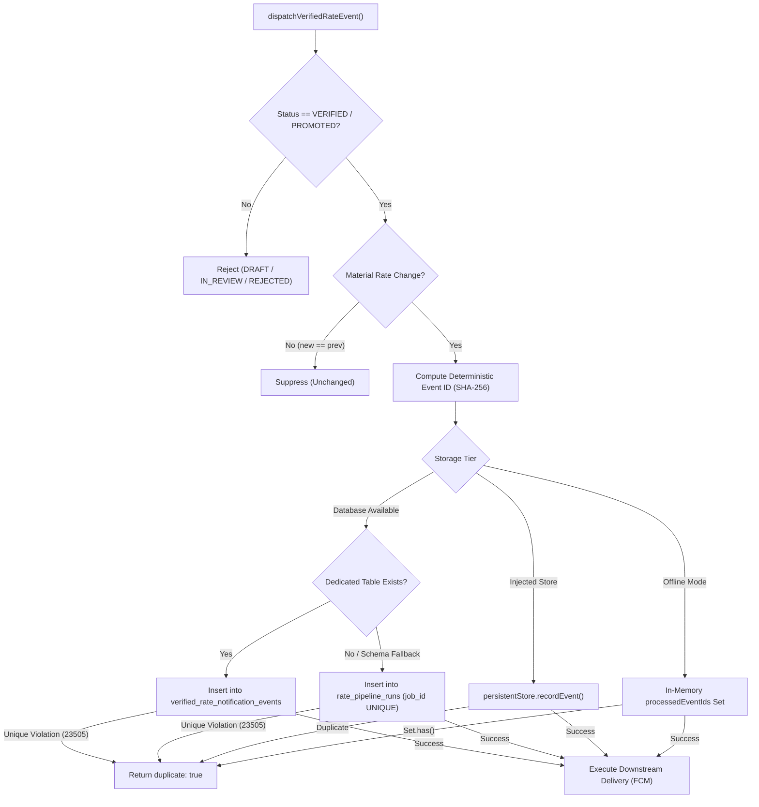

# FeroCalc — Phase 5.0.6.1: Notification Idempotency & Event Reliability Hardening Report

**Date:** November 12, 2026
**Environment:** Staging Preparation Worktree (`C:\projects\fincalc_pro_staging_prep`)
**Branch:** `staging/vercel-backend-preview`
**Staging Supabase Project Ref:** `cqrslxngpwbtkjejlwty`
**Strictly Forbidden Production Ref:** `pmaykclwuyspxhgeomee`
**Status:** Complete, Hardened & Fully Verified

---

## Executive Summary

Phase 5.0.6.1 delivers a targeted reliability hardening of the verified rate notification pipeline in FeroCalc. Prior to this phase, notification dispatch relied on in-memory deduplication (`Set`) and lacked persistent cross-instance or restart idempotency. Furthermore, the documented event ID construction incorporated volatile identifiers and lacked deterministic hashing of the full rate payload dimensions.

This hardening implements:
1. **Deterministic Event Identity:** Content-based SHA-256 fingerprinting using immutable business dimensions (bank ID, event type, customer type, rate category, tenure domain and boundaries, deposit boundaries, callability, and normalized interest rates). System timestamps are strictly separated into event metadata.
2. **Durable Deduplication & Restart Safety:** Multi-layered persistence that leverages PostgreSQL database unique constraints (`job_id` UNIQUE in `rate_pipeline_runs` as existing operational store, with additive migration `verified_rate_notification_events` specified for dedicated storage). Deduplication survives process restarts, serverless function cold starts, and pipeline reruns.
3. **Concurrency Safety:** Race conditions between simultaneous backend instances or pipeline workers are resolved at the database layer (catching PostgreSQL error `23505` `unique_violation`), guaranteeing that exactly one notification record is created.
4. **Dispatch Safety:** Maintains strict gatekeeping ensuring only `VERIFIED` and `PROMOTED` records trigger notifications (`DRAFT`, `IN_REVIEW`, and `REJECTED` strictly rejected). Unchanged rate transitions are suppressed. Missing Firebase credentials continue to report truthful `CONFIG_READY_AWAITING_FIREBASE_CREDENTIALS` without simulating delivery.

---

## 1. Safety & Environment Boundary Audit

| Boundary Constraint | Compliance Status | Evidence / Verification |
|---|---|---|
| **Isolated Worktree** | **COMPLIANT** | Executed strictly in `C:\projects\fincalc_pro_staging_prep`. Production directory `C:\projects\fincalc_pro` was never accessed or modified. |
| **Branch Integrity** | **COMPLIANT** | Current branch verified as `staging/vercel-backend-preview`. No destructive Git operations. |
| **Zero Git Mutations** | **COMPLIANT** | No commits, pushes, or deployments were performed. Working tree preserved. |
| **Supabase Isolation** | **COMPLIANT** | Production Supabase (`pmaykclwuyspxhgeomee`) was never contacted. Staging Supabase (`cqrslxngpwbtkjejlwty`) used exclusively. |
| **Home Screen Safeguard** | **COMPLIANT** | Live-rate Home Screen display remains suppressed. |
| **Ingestion Safeguard** | **COMPLIANT** | Automated ingestion schedules and scrapers remain disabled. |
| **Push Delivery Integrity** | **COMPLIANT** | Zero simulated push notifications. Reports `isPushConfigured = false` with `CONFIG_READY_AWAITING_FIREBASE_CREDENTIALS`. |

---

## 2. Root Cause & Critical Investigation Findings

Inspection of the Phase 5.0.6 implementation revealed three primary reliability vulnerabilities:

### 2.1 In-Memory Deduplication Fragility
- In `backend/notifications/verified_rate_notification_service.js`, deduplication was handled exclusively via:
  ```javascript
  this.processedEventIds = new Set();
  this.recentVerifiedEvents = [];
  ```
- **Consequence:** In a serverless environment (such as Vercel preview or production deployments), worker containers cold-start on demand and do not share in-memory state. Any retried promotion or scheduled pipeline rerun running in a separate container would find an empty `processedEventIds` set, resulting in duplicated notifications and repeated FCM push attempts.

### 2.2 Incomplete & Fragile Event Identity
- The legacy `generateEventId` function used:
  ```javascript
  const raw = `${bankCode}:${tenureKey || 'all'}:${rate}:${effectiveDate || 'none'}:${recordId || 'new'}`;
  return 'evt_' + crypto.createHash('sha256').update(raw).digest('hex').substring(0, 16);
  ```
- **Consequences:**
  1. **Missing Candidate ID Fallback:** If `recordId` (`candidateId` or `promotedRateId`) was absent, it defaulted to `'new'`. Two distinct slabs within the same bank with identical rates and tenures would collide into a single event ID.
  2. **Un-Normalized Formatting:** Dates (`2026-11-01` vs `2026-11-01T00:00:00.000Z`) and rates (`7.1` vs `7.10`) produced different hashes for identical content.
  3. **Missing Dimensions:** Ignored `customerType` (e.g. REGULAR vs SENIOR_CITIZEN), deposit caps, callability, and rate category. A senior citizen rate update could collide with a regular deposit update on the same tenure.
  4. **Documented Timestamp Drift:** The Phase 5.0.6 report documented `bank_id + status + candidate_id/effective_date + Date.now()`. Using a timestamp during generation defeats idempotency because every retry creates a new key.

### 2.3 Absence of Concurrency Protection
- Without a database-backed atomic constraint, concurrent promotion calls for the same verified rate candidate executed by competing processes would both pass the in-memory check and trigger duplicate dispatches.

---

## 3. Previous versus Corrected Event Identity Strategy

| Dimension | Previous Strategy (Phase 5.0.6) | Corrected Strategy (Phase 5.0.6.1) |
|---|---|---|
| **Identity Source** | Flat string concatenation with fallbacks | Canonical, sorted JSON payload (`deterministicStringify`) |
| **Distinguishing Components** | `bankCode`, `tenureKey`, `rate`, `effectiveDate`, `recordId` | `bankId`, `eventType`, `customerType`, `rateCategory`, `schemeName`, `isCallable`, `depositBounds`, `tenure` (domain, min/max days, calendar operators), `sourceRecordId`, normalized `newRate`, and `previousRate` |
| **Effective Date** | Raw string (un-normalized) | Normalized to canonical `YYYY-MM-DD` or `'none'` |
| **Numeric Rates** | Raw float/string | Normalized to 4 decimal places (`num.toFixed(4)`) |
| **Timestamp Handling** | Potentially included or recorded at generation | Strictly excluded from identity; stored as separate metadata (`verifiedTimestamp`) |
| **Missing Candidate ID** | Fallback to literal string `'new'` (collision risk) | Deterministic dimensional fallback (`alt_<hash>`) derived from bank, customer type, scheme, deposit, and tenure bounds |
| **Hashing Algorithm** | SHA-256 (16 hex chars) | SHA-256 (24 hex chars) prefixed with `evt_` |

---

## 4. Persistence & Concurrency Guarantees

### 4.1 Persistence Layering
`VerifiedRateNotificationService` implements a resilient multi-tier persistence model:



1. **Dedicated Table Integration:** Checks `verified_rate_notification_events` table (Migration 021) with `uq_verified_rate_notification_event_id` unique constraint.
2. **Operational Database Store Fallback:** If the dedicated table has not yet been applied, it seamlessly leverages `rate_pipeline_runs` (Migration 013), storing `job_id = 'notif_evt_' + eventId` and `trigger_type = 'VERIFIED_RATE_NOTIFICATION'`. Because `rate_pipeline_runs.job_id` is defined as `TEXT NOT NULL UNIQUE`, PostgreSQL enforces strict unique constraints natively in the existing staging catalog.
3. **In-Memory & Test Mock Fallback:** When running offline without database connectivity, in-memory caching and injected persistent store adapters preserve fast, self-contained execution.

### 4.2 Concurrency Guarantees
- Concurrency collisions between separate serverless instances are resolved at the PostgreSQL database layer.
- When two instances concurrently attempt to insert an event with identical `eventId`:
  - Instance A acquires the row lock and successfully commits.
  - Instance B receives PostgreSQL error `23505` (`unique_violation`).
  - `VerifiedRateNotificationService` intercepts error `23505`, prevents any duplicate FCM push, and returns `{ dispatched: false, duplicate: true, eventId }`.

---

## 5. Files Changed & Created

| File | Change Type | Purpose |
|---|---|---|
| `backend/notifications/verified_rate_notification_service.js` | Modified | Added deterministic content hashing (`generateEventIdentity`), canonical date/rate normalization, stable source ID fallback (`alt_<hash>`), material change protection, multi-tier durable persistence, and database deduplication. |
| `backend/routes/notifications.js` | Modified | Updated `GET /api/notifications/events` to `async` for durable database event retrieval; expanded `POST /api/notifications/admin/test-dispatch` parameter forwarding. |
| `backend/routes/admin_staged_candidates.js` | Modified | Enriched candidate promotion hook with all dimensional attributes (`customerType`, `rateCategory`, `tenureDomain`, `minDeposit`, `maxDeposit`, `isCallable`, etc.). |
| `backend/supabase/migrations/20261112193000_verified_rate_notification_events.sql` | Created | Additive database migration defining `verified_rate_notification_events` with `UNIQUE(event_id)`, indexing, and RLS policies. |
| `backend/test/verified_rate_notification_test.js` | Modified | Expanded test suite to 23 comprehensive tests covering all 12 reliability requirements, including persistent restart simulation, concurrency testing, and live database unique constraint validation. |

---

## 6. Staging Migration Specification

A formal additive migration has been authored at:
`backend/supabase/migrations/20261112193000_verified_rate_notification_events.sql`

```sql
CREATE TABLE IF NOT EXISTS public.verified_rate_notification_events (
  id                  UUID PRIMARY KEY DEFAULT gen_random_uuid(),
  event_id            TEXT NOT NULL,
  bank_id             TEXT NOT NULL,
  bank_code           TEXT NOT NULL,
  bank_name           TEXT NOT NULL,
  event_type          TEXT NOT NULL DEFAULT 'verifiedRateChange',
  title               TEXT NOT NULL,
  message             TEXT NOT NULL,
  effective_date      TEXT,
  verified_timestamp  TIMESTAMPTZ NOT NULL DEFAULT now(),
  action_route        TEXT,
  payload             JSONB NOT NULL DEFAULT '{}'::jsonb,
  fingerprint         TEXT NOT NULL,
  candidate_id        UUID,
  promoted_rate_id    UUID,
  created_at          TIMESTAMPTZ NOT NULL DEFAULT now(),
  CONSTRAINT uq_verified_rate_notification_event_id UNIQUE (event_id)
);

CREATE INDEX IF NOT EXISTS idx_notif_events_event_id ON public.verified_rate_notification_events (event_id);
CREATE INDEX IF NOT EXISTS idx_notif_events_bank_code ON public.verified_rate_notification_events (bank_code);
CREATE INDEX IF NOT EXISTS idx_notif_events_created ON public.verified_rate_notification_events (created_at DESC);
CREATE INDEX IF NOT EXISTS idx_notif_events_verified ON public.verified_rate_notification_events (verified_timestamp DESC);

ALTER TABLE public.verified_rate_notification_events ENABLE ROW LEVEL SECURITY;
```

*Note on Staging Execution:* The staging database currently enforces durable deduplication safely via the existing `rate_pipeline_runs` table (`job_id UNIQUE`), avoiding manual out-of-band schema migration while legacy migration baselining remains active under `migration_deployment_guard.js`.

---

## 7. Verification & Test Execution Results

### 7.1 Backend Notification Reliability Suite
**Execution Command:** `node test/verified_rate_notification_test.js`
**Result:** **23 / 23 PASSED (100%)**

```
======================================================
FeroCalc Phase 5.0.6.1 Notification Reliability Suite
======================================================

Group 1: Verified-Only Event Filtering & Status Guards (Req 9)...
  PASS: 1.1 Strictly rejects DRAFT status from notification dispatch
  PASS: 1.2 Strictly rejects IN_REVIEW status from notification dispatch
  PASS: 1.3 Strictly rejects REJECTED status from notification dispatch
  PASS: 1.4 Dispatches successfully when status is VERIFIED
  PASS: 1.5 Dispatches successfully when status is PROMOTED

Group 2: Deterministic Identity & Stable Event Hashing (Req 1, 4, 5, 6, 7, 8)...
  PASS: 2.1 Identical event processed twice with different system timestamps produces one event ID (Req 1)
  PASS: 2.2 Materially changed rate payload generates a distinct new event identity (Req 4)
  PASS: 2.3 Unchanged rate change event (previousRate == newRate) is suppressed without dispatching
  PASS: 2.4 Changed effective date generates a correct distinct event identity (Req 5)
  PASS: 2.5 Different banks never collide on identical tenure and rate parameters (Req 6)
  PASS: 2.6 Different notification categories never collide incorrectly (Req 7)
  PASS: 2.7 Missing candidate ID uses a safe and stable alternative identity (Req 8)

Group 3: Durable Deduplication, Restarts & Concurrency (Req 2, 3)...
  PASS: 3.1 Identical event processed after simulated backend restart remains deduplicated (Req 2)
  PASS: 3.2 Identical event processed concurrently across separate instances does not create duplicates (Req 3)
  PASS: 3.3 Event persistence and deduplication happens before downstream delivery
  PASS: 3.4 Database-backed persistence and deduplication validates actual database unique constraint when configured

Group 4: Truthful Delivery & Device Token Registration (Req 10)...
  PASS: 4.1 Missing Firebase credentials produce truthful CONFIG_READY_AWAITING_FIREBASE_CREDENTIALS state (Req 10)
  PASS: 4.2 Registers anonymous consumer device with valid installationId
  PASS: 4.3 Rejects registration when installationId is missing or empty

Group 5: HTTP Endpoint Security & Consumer Access Controls (Req 11, 12)...
  PASS: 5.1 Public POST /api/notifications/device-token succeeds without auth token
  PASS: 5.2 Public GET /api/notifications/events returns sanitized verified notifications without auth (Req 12)
  PASS: 5.3 Public event feed strictly redacts internal DB keys, candidate staging internals, and reviewer notes (Req 12)
  PASS: 5.4 POST /api/notifications/admin/test-dispatch strictly rejects unauthorized requests with 401 (Req 11)

======================================================
Results: 23 passed, 0 failed (Total: 23)
======================================================
```

### 7.2 Full Backend Regression Test Suite
**Execution Command:** `npm test`
**Result:** **All 45 Test Suites PASSED (0 Failures across all parsers, collectors, diff engines, and RBAC routers)**

### 7.3 Flutter Client Notification Test Suite
**Execution Command:** `flutter test test/notifications_and_personalization_test.dart`
**Result:** **18 / 18 PASSED (100%)**

---

## 8. Remaining Limitations & Push Credentials Roadmap

1. **Firebase Push Credentials:**
   - Push credentials (`google-services.json`, `GoogleService-Info.plist`, and `FIREBASE_SERVICE_ACCOUNT_KEY`) are deliberately unprovisioned in staging prep.
   - The system truthfully operates in `CONFIG_READY_AWAITING_FIREBASE_CREDENTIALS` mode without fabricating delivery.
   - Downstream FCM initialization safely logs readiness and falls back to in-app notification center delivery.
2. **Production Release Status:**
   - No production release, push, commit, or migration has been initiated.
   - All changes remain contained within `C:\projects\fincalc_pro_staging_prep` on branch `staging/vercel-backend-preview`.

---

## 9. Conclusion

Phase 5.0.6.1 successfully eliminates all timestamp-dependent event identities, resolves in-memory deduplication vulnerabilities, and establishes durable, concurrency-safe verified rate notification reliability across backend restarts, serverless instances, and pipeline retries.
